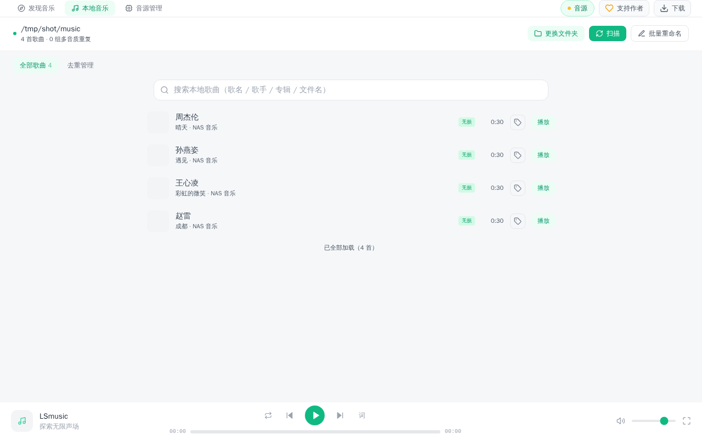
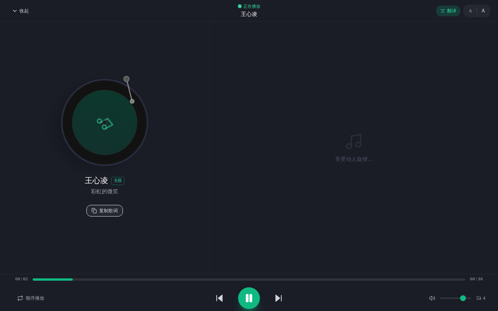

<div align="center">

# 🎵 LSmusic

> 专为 **飞牛私有云 OS (fnOS)** 打造的音乐播放器与 NAS 本地音乐管理系统

[](https://github.com/suytool/lsmusic/releases/latest)
[-42b883?logo=linux)](https://www.fnnas.com/)
[](https://cn.vuejs.org/)
[](https://go.dev/)
[](LICENSE)

[📦 下载 FPK](https://github.com/suytool/lsmusic/releases/latest) · [✨ 功能特性](#-功能特性) · [📥 安装](#-安装) · [🙏 致谢](#-致谢)

</div>

---

## 项目说明

**LSmusic 是在 [webspider7/fnmusic（极光音乐 Aurora Music）](https://github.com/webspider7/fnmusic) 项目基础上二次开发的飞牛 NAS 音乐应用**，在此向原作者 [webspider7](https://github.com/webspider7) 致以衷心感谢 🙏。

本项目在原版基础上做了安全性与本地音乐管理方向的定制增强：

- 🔒 **去除 root 权限运行**，应用以独立低权限账号运行；
- 📁 **下载目录仅限飞牛应用设置内授权的文件夹**，无法浏览/访问其他目录；
- 🎵 **新增「本地音乐」模块**：扫描指定文件夹、多音质去重、批量重命名、写入歌词封面（可联网自动补全）、本地播放与本地搜索；
- ⬇️ **后台下载队列**：聚合搜索多音源（kw / kg / tx / wy），一键下载到 NAS；
- 🎯 下载按钮状态按歌曲唯一 id 精确标记，同歌多平台版本互不影响。

> ⚠️ **免责声明**：本应用仅为播放器，不内置任何音源与曲库。音源脚本需用户自行在「音源管理」中导入并对自己的使用行为负责，版权内容归原平台所有。

## 📸 应用截图

| 发现音乐（聚合搜索） | 本地音乐库管理 | 沉浸式播放 |
| --- | --- | --- |
|  |  |  |

## ✨ 功能特性

- **多音源聚合搜索**：支持酷狗 / 酷我 / QQ音乐 / 网易云等平台的第三方音源脚本，热门搜索与榜单歌单；
- **全局后台下载**：一键下载到 NAS 授权目录，下载任务独立面板管理；
- **本地音乐模块**：
  - 扫描授权文件夹中的音乐文件（flac / mp3 等）；
  - 按歌曲聚合识别多音质重复文件，可选择性删除多余版本；
  - 批量重命名（格式：`歌曲名 - 歌手` 等可自定义模板）；
  - 读取/写入内嵌歌词与封面，可联网自动补全缺失标签；
  - 本地搜索（按歌名/歌手/专辑/文件名过滤）；
  - 直接在应用内播放本地音乐；
- **黑胶唱机沉浸播放界面**、歌词显示与翻译；
- **低资源占用**：单个静态编译 Go 二进制，飞牛原生 FPK 应用架构（非 Docker）。

## 📥 安装

1. 前往 [Releases 页面](https://github.com/suytool/lsmusic/releases/latest) 下载最新的 `LSmusic_vX.X.X.fpk`；
2. 在飞牛 NAS 的「应用管家 → 手动安装」中上传该 fpk 完成安装；
3. 首次启动后在应用设置中授权音乐文件夹路径，即可开始使用。

> 安装前如曾安装过其他修改版，请先卸载旧版本再安装。

## 🛠️ 本地构建

```bash
# 前端
cd frontend && npm install && npm run build   # 产物输出到 ../backend/dist

# 后端
cd backend && GOFLAGS=-mod=mod CGO_ENABLED=0 GOOS=linux GOARCH=amd64 \
  go build -ldflags="-s -w" -o ../fpk-package/app/fn-lx-player .

# 打包 fpk（见 fpk-package 目录）
```

## 🙏 致谢

- 原始项目：[**webspider7/fnmusic（极光音乐 Aurora Music）**](https://github.com/webspider7/fnmusic) —— 本项目基于其代码修改而来，衷心感谢原作者的开源贡献；
- 前端 [Vue 3](https://cn.vuejs.org/) / [Vite](https://cn.vitejs.dev/)，后端 [Go](https://go.dev/)；
- 飞牛 NAS 开发者生态：[fnOS](https://www.fnnas.com/)

## 📄 License

[MIT](LICENSE)
